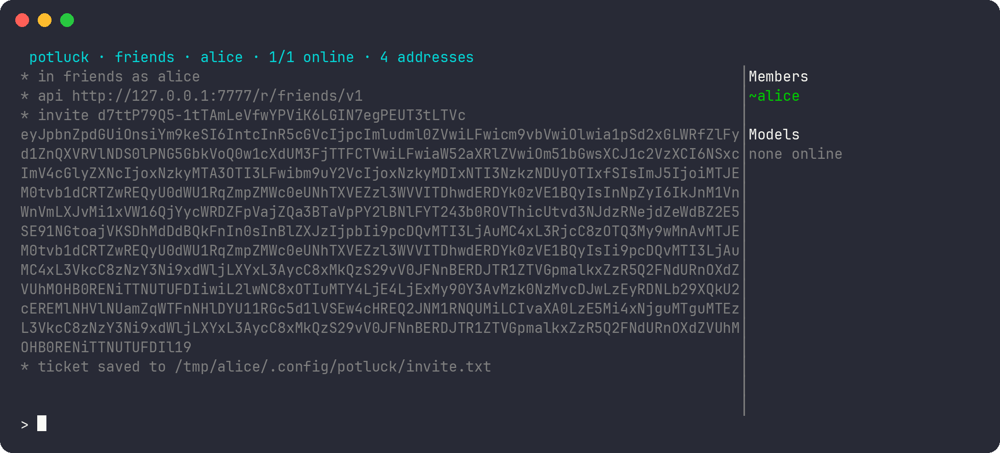
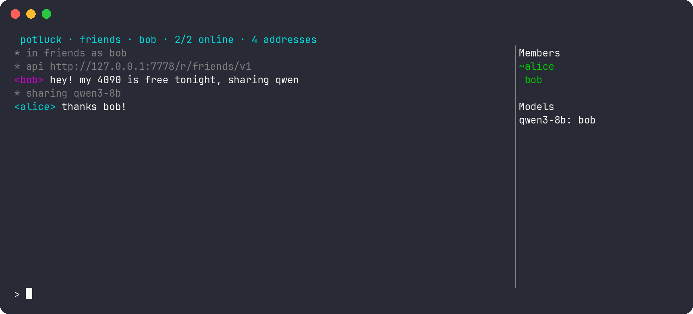
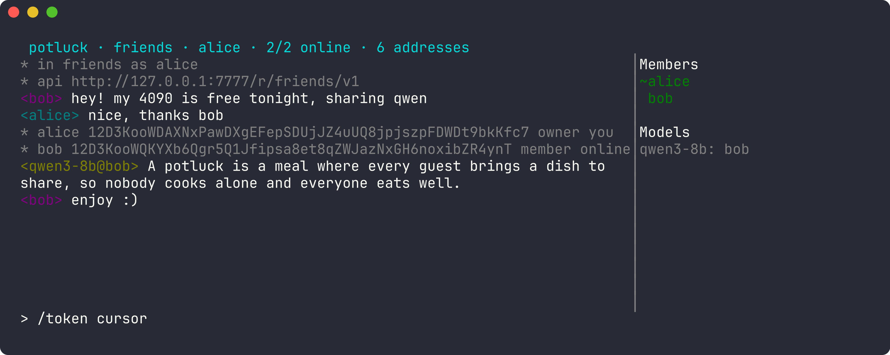
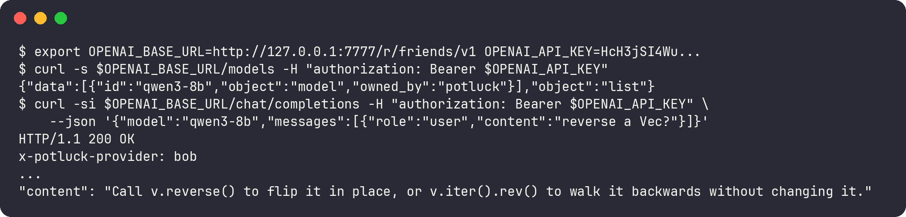

<p align="center"></p>

# Potluck

Your GPU idles most of the day. So do your friends'. Potluck pools them: invite-only rooms where you chat and share local models peer-to-peer, through any NAT, encrypted end to end. No server, no API keys handed around, no one else holding your prompts. Every app in the room gets one OpenAI-compatible endpoint backed by everyone's hardware.

## Problem

- Friends and teams run local models (llama.cpp, vLLM, Ollama) but can't easily use each other's.
- Sharing one needs network setup, per-person credentials, and a way to see whose GPU is free.
- Hosted services hold every prompt and decide who gets access.

## Quick start

```sh
cargo build --release
potluck relay --port 4001                    # on a reachable host; prints: listening <addr>
potluck create friends --nick alice          # prints: room <id>
```

1. **Invite.** alice runs `potluck chat friends --relay <addr>`, types `/invite`, and sends bob the ticket saved in `invite.txt`.
   
2. **Join and share.** bob runs `potluck join <ticket> --nick bob --relay <addr>`, then `/share qwen3-8b http://127.0.0.1:11434` to serve the model from Ollama.
   
3. **Ask.** alice runs `/models` to see who serves what, then `/ask qwen3-8b <prompt>`; bob's GPU answers.
   
4. **Use it from apps.** alice runs `/token <app>` and points any OpenAI client at the [local endpoint](#local-endpoint).

`chat` and `join` open a full-screen TUI (PageUp/PageDown scroll, Up/Down history, Ctrl-C quits); piped, they read and write plain lines. Flags: `--relay <addr>` (needed behind NAT), `--api <addr>` (endpoint, default `127.0.0.1:7777`), `--dir <path>` (state, default `~/.config/potluck/`).

## Commands

| Command | Effect |
|---|---|
| `/invite [uses] [hours] [peer-id]` | owner: write a ticket to `invite.txt` (limited-use, expiring, optionally bound to one key) |
| `/revoke <id>`, `/remove <nick>` | owner: cancel an invite; lock a member out |
| `/who` | members and who's online |
| `/share <model> <backend-url> [max_concurrent] [per_min] [max_tokens]` | serve a local OpenAI-compatible backend's model to the room (defaults 1, 30, none) |
| `/unshare <model>` | stop now; in-flight streams end with an error |
| `/models`, `/ask <model> <prompt>` | list online models and providers; ask one |
| `/pin <nick>`, `/block <nick>` | toggle: prefer a provider; refuse to use or serve a member |
| `/token <app>` | bearer token for the local endpoint |
| `/quit`, other lines | leave; chat message |

## Local endpoint

Point any OpenAI-compatible client at `http://127.0.0.1:7777/r/<room>/v1` with a `/token` bearer token.

- Serves `GET models` and `POST chat/completions` (streaming or not).
- Names the serving member in the `x-potluck-provider` header; returns 503 when no member serves the model.
- Accepts only local callers: loopback bind, per-app token, no browser `Origin`, loopback `Host`.



## How it works

| Piece | Role |
|---|---|
| Node | one `potluck` binary per person; ed25519 key = libp2p peer ID = identity |
| Room | owner-created, invite-only, 2-30 people; membership = signed events every member merges |
| Relay | any reachable node; forwards encrypted circuits for peers behind NAT, then DCUtR tries a direct path |
| Provider | member that `/share`s a model; forwards requests to its localhost backend within its limits |
| Router | picks a provider from heartbeats (pinned first, then least busy), streams the answer back over Noise |

Trust ends at the room: members see each other's chat and models; providers see the prompts they serve. Nothing about a room is published. Chat has no history: members see messages while online.

## Docs

| Doc | Covers |
|---|---|
| [docs/design.md](docs/design.md) | principles, concepts, membership rules, routing, owner controls |
| [docs/security.md](docs/security.md) | security properties and threat model |
| [docs/protocol.md](docs/protocol.md) | wire protocols and on-disk state |
| [docs/development.md](docs/development.md) | stack, source layout, tests |
| [docs/roadmap.md](docs/roadmap.md) | status, phases, deferred features and their triggers |
