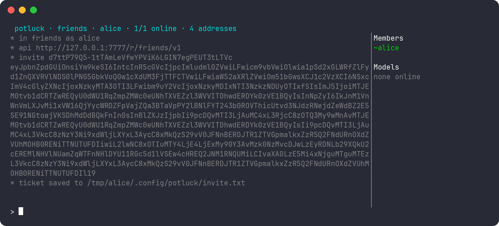
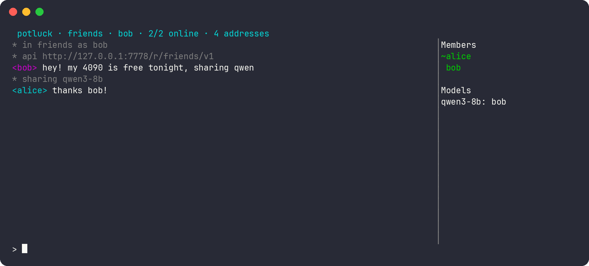
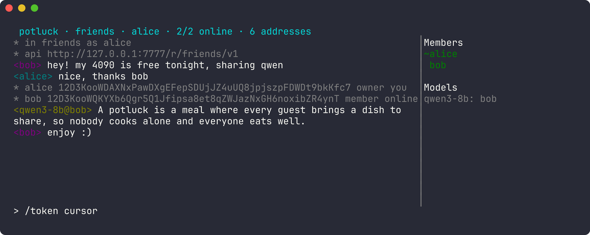
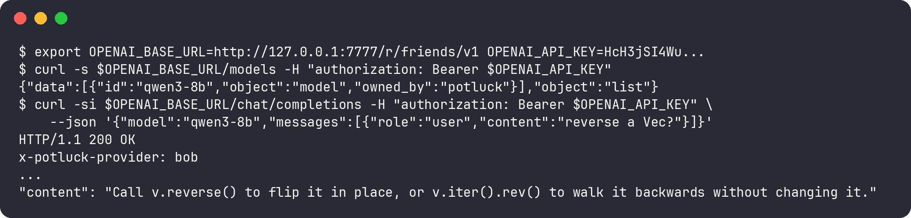

<p align="center"></p>

# Potluck

Your GPU sits idle most of the day, and so do your friends'. Potluck pools them. You create an invite-only room where people chat and share the models they run locally. Traffic goes directly between members, through any NAT, encrypted end to end. There is no server to run, no API keys to hand around, and nobody else holding your prompts. Every app on your machine gets one OpenAI-compatible endpoint backed by everyone's hardware.

## Why

Plenty of friends and teams run local models with llama.cpp, vLLM or Ollama, but using each other's is harder than it should be. Sharing one usually means opening ports, handing out credentials to each person, and having no way to tell whose GPU is free. The alternative is a hosted service, which sees every prompt and decides who gets access. Potluck is for people who already trust each other and want neither.

## Quick start

Potluck builds on Linux and macOS with Rust 1.88 or newer.

```sh
cargo install --path .                # installs the potluck binary
potluck relay --port 4001             # on a reachable host; prints "listening <addr>"
potluck create friends --nick alice   # prints "room <id>"
```

The relay is only needed when members sit behind NAT, which is the usual case. Pass one of the addresses it prints as `--relay <addr>` in the steps below.

1. **Invite.** Alice runs `potluck chat friends --relay <addr>` and types `/invite`. The ticket is printed and also saved to `~/.config/potluck/invite.txt`, which she sends to Bob.

   

2. **Join and share.** Bob runs `potluck join <ticket> --nick bob --relay <addr>`. Once he is in, `/share qwen3-8b http://127.0.0.1:11434` offers the model his Ollama serves to the room.

   

3. **Ask.** Alice types `/models` to see who serves what, then `/ask qwen3-8b <prompt>`. Bob's GPU answers.

   

4. **Use it from apps.** Alice types `/token <app>` and points any OpenAI client at the [local endpoint](#local-endpoint).

`chat` and `join` open a full-screen TUI. PageUp and PageDown scroll, Up and Down recall earlier input, and Ctrl-C quits. When input or output is piped, they read and write plain lines instead, which is what the tests and scripts use. `chat` finds a room by its name or by a prefix of its id.

A nick is 1 to 32 letters, digits, `-`, `_` or `.`, and defaults to `$USER`. It has to be unique among the room's current members, ignoring case, and a join with a taken nick is refused.

| Flag | Meaning |
|---|---|
| `--relay <addr>` | Relay to listen through when behind NAT. The address must end in `/p2p/<id>`, as printed by `potluck relay`. |
| `--api <addr>` | Where the local endpoint listens. Defaults to `127.0.0.1:7777`. |
| `--dir <path>` | Where state is kept. Defaults to `~/.config/potluck/`. |

## Commands

Anything you type that does not start with `/` is a chat message.

| Command | What it does |
|---|---|
| `/invite [uses] [hours] [peer-id]` | Owner only. Writes a ticket to `invite.txt`. It works once and expires after 24 hours unless you say otherwise, and a peer id binds it to one person's key. |
| `/revoke <invite-id>` | Owner only. Cancels an invite, using the id printed by `/invite`. |
| `/remove <nick>` | Owner only. Locks a member out of the room. |
| `/who` | Lists members, their peer ids, and who is online. |
| `/share <model> <backend-url> [max_concurrent] [per_min] [max_tokens]` | Serves a model from a local OpenAI-compatible backend to the room. By default it runs one request at a time, allows each member 30 requests a minute, and sets no token cap. |
| `/unshare <model>` | Stops sharing at once. Streams in flight end with an error. |
| `/models` | Lists the models online and who provides them. |
| `/ask <model> <prompt>` | Asks a model and prints the answer when it is complete. |
| `/pin <nick>` | Toggles a preference for this member as a provider. |
| `/block <nick>` | Toggles a block: you neither use this member's models nor serve them. |
| `/token <app>` | Creates a bearer token for the local endpoint, replacing any earlier token for that app. |
| `/quit` | Leaves the room. |

## Local endpoint

Point any OpenAI-compatible client at `http://127.0.0.1:7777/r/<room>/v1`, where `<room>` is the room's name or id, and give it a bearer token from `/token`.

The endpoint serves `GET models` and `POST chat/completions`, streaming or not. Each answer names the member who served it in the `x-potluck-provider` header.

When a provider refuses a request, the router tries the next one. A refusal means the provider does not allow you, no longer shares the model, is rate limited or busy, or cannot be reached. A backend that answers 429 or 503 counts as busy too, and a provider that stays silent for 10 minutes is skipped. If nobody can serve the model, you get a 503 carrying the last reason. A request the backend rejects as malformed (400) comes back as is, and a request of 1 MiB or more is refused with 413 by your own node before any provider is contacted.

Models you share yourself are served straight from your local backend, without the share's limits.

Only local callers are accepted. The endpoint binds to loopback unless `--api` says otherwise, requires a per-app token, rejects any request that carries a browser `Origin` header, and insists on a loopback `Host`.



## How it works

Each person runs one `potluck` binary, a node. Its ed25519 key is both its libp2p peer ID and its identity in every room.

A room is created by its owner and is invite-only, built for 2 to 30 people. Membership is a set of signed events that every member holds and merges, so no member is special once they are in.

Members connect to each other directly. For those behind NAT, a `potluck relay` on a reachable host forwards encrypted circuits while DCUtR tries to punch a direct path.

A member who runs `/share` becomes a provider. Their node forwards requests to the backend, normally on localhost, within the limits they set. Providers announce their models and load in heartbeats. The router on the asking side picks one, preferring pinned members and then the least busy, and streams the answer back over the encrypted connection.

Trust ends at the room. Members see each other's chat and models, and a provider sees the prompts it serves. Nothing about a room is published anywhere. Chat keeps no history, so members only see messages sent while they are online.

## Docs

| Doc | Covers |
|---|---|
| [docs/design.md](docs/design.md) | Principles, concepts, membership rules, routing, provider controls |
| [docs/security.md](docs/security.md) | Security properties and threat model |
| [docs/protocol.md](docs/protocol.md) | Wire protocols and on-disk state |
| [docs/development.md](docs/development.md) | Stack, source layout, tests |
| [docs/roadmap.md](docs/roadmap.md) | Status, known limits, and deferred features with their triggers |
